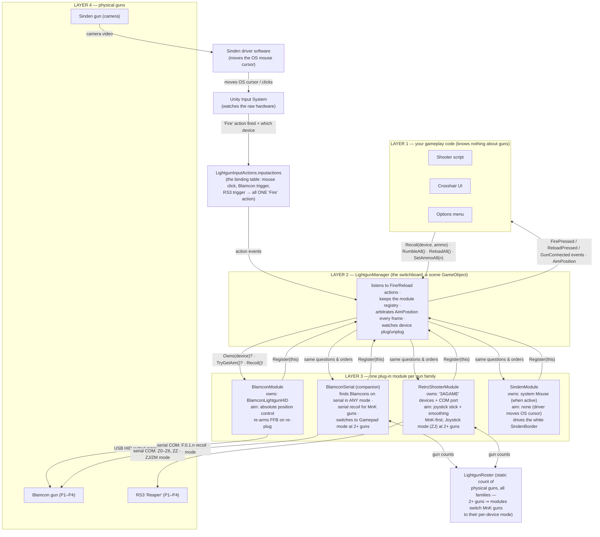
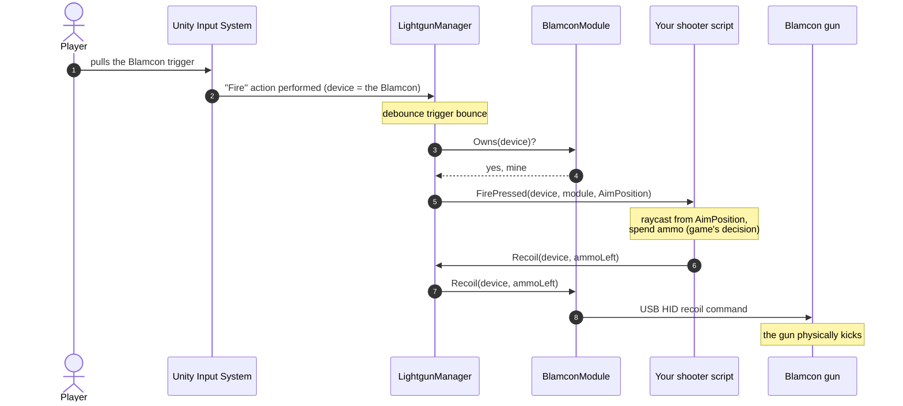
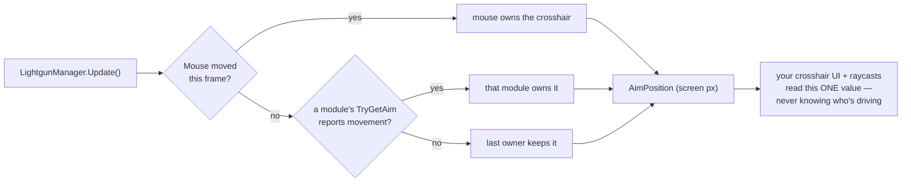

# Lightgun Layer — Architecture Map

Visual companion to `scene-setup-guide.md`. The diagrams below render automatically on GitHub
(and in VS Code with a Mermaid preview extension). A hand-styled single-page version is
`architecture-map.html` in this folder.

Reading key: **game code and gun hardware never talk to each other directly** — every
conversation passes through the `LightgunManager` switchboard.

## The layers — what talks to what

Note the **Sinden loop** at the bottom: the Sinden's hardware never receives anything from us.
Its camera feeds its own driver software, which moves the OS cursor — which re-enters the map at
the top through Unity's mouse input. Our only job for it is rendering the border
(`SindenBorder`) its camera needs to see.

And the **mode policy** on the left: `BlamconSerial` and `RetroShooterModule` each report their
physical gun count (countable in ANY input mode, via each family's serial side) to the static
`LightgunRoster`. One gun ⇒ it stays in whatever mode it arrived in and plays through the mouse
path with serial recoil (MnK-first). The moment the roster sees **2+ guns**, MnK-mode guns are
switched to their per-device mode — Blamcon → Gamepad, RS3 → Joystick — because two mice can't
share one OS cursor. Switched guns are restored on exit.

## One shot, end to end

A **plain mouse click** follows steps 1–6 identically (that's the device-agnostic part) but
stops there: no module owns a mouse, so `Recoil` finds nobody and nothing kicks. (Exception by
design: while a single MnK-mode gun is confirmed on serial, its module claims mouse shots so
recoil still reaches the gun — see the MnK-first policy in `scene-setup-guide.md` Step 6.)

## Aiming, every frame

## Where everything lives

| Piece | File |
|---|---|
| The switchboard | `Runtime/LightgunManager.cs` |
| Module contract | `Runtime/ILightgunModule.cs` + `Runtime/LightgunModule.cs` (base) |
| Mode-policy gun count | `Runtime/LightgunRoster.cs` |
| Gun drivers | `Runtime/Modules/RetroShooterModule.cs`, `Runtime/Modules/SindenModule.cs`, `Runtime/Blamcon/BlamconModule.cs` |
| Blamcon serial companion | `Runtime/Blamcon/BlamconSerial.cs` |
| Sinden border overlay | `Runtime/SindenBorder.cs` |
| Binding table + smoke test | `Samples~/Setup/` (import via Package Manager) |
| Blamcon HID device layout | `Runtime/Blamcon/Device/` (vendored from `com.blamcon.lightguns`, MIT) |
| Setup walkthrough | `Documentation~/scene-setup-guide.md` |
